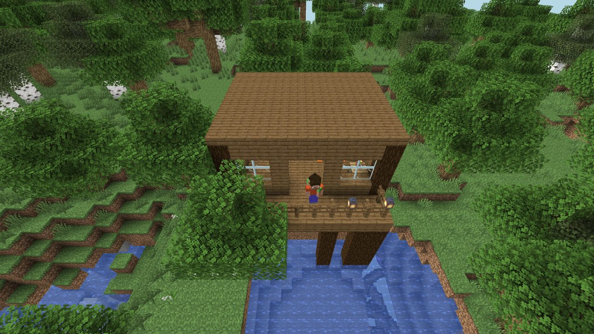
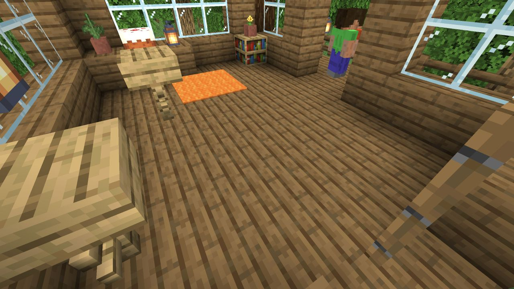

# Minecraft Multi-Agent Lab

A local, two-agent Minecraft building demo based on [Mindcraft](https://github.com/mindcraft-bots/mindcraft). RiverScout and StoneKeeper can discuss a task, inspect blocks, build in creative mode and report the results. A browser spectator lets you watch their shared world.

The example world contains the villa, garden and lakeside café from the demo. The agents use structured game-state and action feedback; the default setup does not send screenshots to the model.




## Requirements

- Node.js and npm; the demo was run with Node 24.
- Java 21 and the official **Minecraft Java Edition 1.21.6 server**. Obtain the matching server jar from [the official 1.21.6 release page](https://www.minecraft.net/en-us/article/minecraft-java-edition-1-21-6) and accept its EULA yourself.
- An OpenAI API key and access to the model configured in the agent profiles, or a compatible local model gateway configured in their place. Model calls can incur charges.

The example uses an offline-mode server bound to `127.0.0.1`. Keep this demo on your own machine: offline mode does not authenticate player identities.

## Setup

1. Install Mindcraft's dependencies and patch the local spectator:

   ```sh
   cd mindcraft
   npm ci
   patch -N -p1 < ../runtime/spectator-server.patch
   cd ..
   node garden-viewer-patch.mjs
   node runtime/patch-viewer-height.mjs
   ```

2. Create a server directory outside the source checkout. Copy `server.properties.example` there as `server.properties`, copy `example-world/mindcraft-garden` into that directory, and put the official 1.21.6 server jar there as `server.jar`. Start it with `java -Xms512M -Xmx2G -jar server.jar nogui` and follow the server's EULA instructions.

3. In another terminal, set `OPENAI_API_KEY` locally and start `node villa-terra.mjs`. The gateway only listens on `127.0.0.1:18084`. `MAX_REQUESTS` can lower its default 1000-attempt limit. Its historical cost calculation is an approximation, not an OpenAI billing statement or a guaranteed spending limit. Select a model available to your account by setting `OPENAI_MODEL` and updating the `model` field in both profiles.

4. In another terminal start the agents:

   ```sh
   cd mindcraft
   SETTINGS_JSON="$(cat ../settings.villa.json)" node main.js
   ```

   In the Minecraft server console, give the two local agents creative build permissions with `op RiverScout` and `op StoneKeeper`.

5. In another terminal start the spectator from the repository root:

   ```sh
   CAMERA_VERSION_BRIDGE=1 node garden-camera.mjs
   ```

   Open <http://localhost:3002/>. In the server console, `tp GardenCamera -26 72 61` centers it near the café. Drag to orbit and scroll to zoom. The viewer loads a limited area around the camera and is not the official Minecraft client.

6. Send an initial goal from the repository root, for example:

   ```sh
   node send-local.mjs RiverScout '!goal("Discuss a small garden improvement with StoneKeeper, build it, verify it, then finish.")'
   ```

## Contents and verification

The `mindcraft/` directory includes the upstream project at commit `e1c1fc3ffa481506c2445fc639e16dba504b5920` and local modifications for bounded creative-mode building, interaction, walking and agent conversation. `runtime/` contains the spectator's block-state and height compatibility fixes. The example world omits player profiles, statistics and runtime logs. Server binaries, API credentials, generated usage records and agent memories are not included.

After dependency installation, run:

```sh
cd mindcraft && node --test test/conversation.test.js test/villa-tools.test.js
cd .. && node --test runtime/viewer-version-bridge.test.cjs
node runtime/viewer-height-worker-test.cjs
```

Mindcraft's original [MIT license](mindcraft/LICENSE) and copyright notice are preserved.
